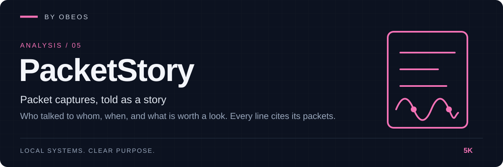

<div align="center">



**Packet captures, told as a story. Who talked to whom, when, and what is worth a look.**

[](https://github.com/5K-bit/PacketStory/actions/workflows/ci.yml)


[](LICENSE)

</div>

[Quick start](#quick-start) · [Demonstration](#demonstration) · [Tests](#tests-and-evidence) · [Limitations](#limitations)

---

## Overview

PacketStory reads a **pcap or pcapng** capture and writes what happened in plain sentences: *the workstation asked the resolver for example.test, connected to it over TLS, sent 376 bytes and received 5 KiB, and a FIN was observed from both sides.* Every line cites the **packet numbers** it rests on, so you can check it in a packet viewer. A short **Worth a look** list points at a few patterns, labelled as heuristics.

Part of the OBEOS projects, and it works completely on its own. No server, no account, no network access (not even DNS lookups); it opens one file and writes one report.

> **Authorised captures only.** A capture holds private traffic. PacketStory never prints an `Authorization` value, an HTTP query string, a URL password or any payload body. It does print addresses, DNS and TLS names, HTTP hosts and paths, and those can themselves be sensitive (a path can carry an ID, a name can reveal a service). A report shows who talked to whom, so treat it like the capture. See [Limitations](#limitations).

## Demonstration

A real run on a synthetic capture ([`examples/lab/lab.pcap`](examples/lab/lab.pcap), 95 packets, built by hand from documentation-range addresses; nothing was captured from a real network). A workstation browses, fails to resolve six odd names, sends credentials over plain HTTP, and a scanner walks 30 ports on the jump host. Excerpt; the full output is in [docs/evidence](docs/evidence/) ([Markdown](docs/evidence/story.md) · [HTML](docs/evidence/story.html) · [JSON](docs/evidence/story.json)).

```text
$ packetstory summary examples/lab/lab.pcap
lab.pcap: pcap, 95 packets over 14.7 s
protocols: icmp 2, tcp 76, udp 17
conversations: 44  hosts: 7  events: 17 (3 worth a look)

$ packetstory story examples/lab/lab.pcap
- `2026-10-29T17:00:00.501Z` [pkt 3–4] 192.0.2.10 asked 192.0.2.53 for example.test (A) and got 203.0.113.7.
- `2026-10-29T17:00:00.522Z` [pkt 5–13] 192.0.2.10 connected to example.test (203.0.113.7) port 443/tcp (https), TLS to example.test; 376 B sent, 5.1 KiB received over 8 ms; FIN observed from both sides.
- `2026-10-29T17:00:09.685Z` [pkt 36–87] Possible port scan: 198.51.100.77 tried 30 ports on 1 host(s) within 51 ms; 28 got no answer or were refused. Ports that answered: 22, 25. (A heuristic: it looks like a scan, it does not prove intent.)
- `2026-10-29T17:00:14.739Z` [pkt 90–95] 192.0.2.10 connected to 192.0.2.50 port 22/tcp (ssh); 61 B sent, 101 B received over 5 ms; reset by the server.

## Worth a look
- [pkt 16–22] 192.0.2.10 sent an HTTP request to api.example.test with an Authorization header (Basic) over an unencrypted connection. The value is not shown here.
- [pkt 23–34] 192.0.2.10 had 6 different names fail to resolve (for example b2k8yy.invalid, m7d4tt.invalid, q8w2pz.invalid). Misconfiguration and malware both cause this; the capture alone cannot say which.
- [pkt 36–87] Possible port scan: 198.51.100.77 tried 30 ports on 1 host(s) …
```

The credential itself is never printed. Reproduce it: `python examples/acceptance.py --out /tmp/evidence`.

## Quick start

**Requirements:** Python 3.11 or newer.

```bash
git clone https://github.com/5K-bit/PacketStory && cd PacketStory
pip install .                                    # no other dependencies
packetstory summary capture.pcap                 # size, protocols, busiest hosts
packetstory story capture.pcap                   # the timeline, as Markdown on screen
packetstory story capture.pcap --format html --out story.html
packetstory flows capture.pcap --limit 20        # one line per conversation
```

Try it without a capture of your own: `packetstory story examples/lab/lab.pcap`.

| Command | Purpose |
|---|---|
| `summary FILE` | Packets, time span, protocols, conversations, top senders, damage warnings |
| `flows FILE [--limit N]` | One line per conversation: endpoints, service, state, bytes, packet range |
| `story FILE [--format md\|html\|json] [--out F] [--max-events N] [--strict]` | The narrated timeline and *Worth a look* notes |

Exit codes: 0 ok, 1 error (unreadable file, not a capture), 2 with `--strict` when part of the capture could not be read.

## What it understands

- **Files:** classic pcap (either byte order, microsecond or nanosecond) and pcapng (including timestamp resolution). Not compressed files.
- **Links and packets:** Ethernet (with VLAN tags), Linux cooked, raw IP and loopback; IPv4, IPv6, ARP, TCP, UDP, ICMP, ICMPv6.
- **Applications:** DNS queries and answers, plain HTTP/1.x requests and responses, and the server name in a TLS ClientHello. That is all; nothing is decrypted.
- **Notes:** possible port scans, repeated failed DNS lookups, and credentials sent over cleartext HTTP. Thresholds are named constants in [`story.py`](src/packetstory/story.py).

## Architecture

```
file ─► capture ─► decode ─► flows ─► story ─► render
       pcap/pcapng  L2–L4    conversations  events with   Markdown · HTML · JSON
                    never    + DNS/HTTP/TLS  packet        text from the capture
                    raises   fields          citations     is escaped
```

Details: [docs/architecture.md](docs/architecture.md) · [threat model](docs/threat-model.md) · decisions in [docs/adr/](docs/adr/).

## Tests and evidence

```bash
pip install -e ".[dev]"
ruff check . && ruff format --check . && mypy
python -m pytest --cov
```

The last recorded run (Linux, Python 3.13) is in [docs/evidence/test-run.txt](docs/evidence/test-run.txt). What each claim rests on:

| Claim | Evidence |
|---|---|
| pcap and pcapng are read in both byte orders and resolutions; truncated, oversized, malformed and non-capture files are handled | [`tests/unit/test_capture.py`](tests/unit/test_capture.py) |
| Link, IP, TCP, UDP, ICMP and ARP decode; bad headers are flagged, never raised; DNS, HTTP and TLS readers resist hostile input and keep no credential value or query string | [`tests/unit/test_decode_appproto.py`](tests/unit/test_decode_appproto.py) |
| Conversations, TCP states, scans (both sides of the threshold), DNS failures, cleartext credentials and names learned from DNS | [`tests/unit/test_flows_story.py`](tests/unit/test_flows_story.py) |
| Reports match golden files; hostile names are neutralised in every format; 400 mutated captures never crash any renderer | [`tests/unit/test_render_fuzz.py`](tests/unit/test_render_fuzz.py) with [golden files](tests/fixtures/) |
| CLI behaviour and exit codes; the lab story and its reports reproduce the recorded evidence exactly | [`tests/integration/test_cli_acceptance.py`](tests/integration/test_cli_acceptance.py), [evidence](docs/evidence/) |
| 180,000 packets analyse in a few seconds | [docs/evidence/scale.txt](docs/evidence/scale.txt) (one machine, one run) |

## Limitations

PacketStory does not claim more than it has shown:

- **Heuristics, not verdicts.** The *Worth a look* rules are simple and can be wrong either way. A quiet report is not proof that nothing happened.
- **Tested on synthetic captures.** The lab and the fuzzing are hand-built. Real captures from other tools, odd link types and unusual traffic may expose gaps. Send a sanitised reproduction if one fails.
- **No reassembly, no checksums.** IP fragments are flagged, not reassembled; TCP streams are not reordered; checksums are not validated. Anything split across packets (a TLS hello in two segments, say) may be missed.
- **Plain HTTP and TLS server names only.** HTTP/2, QUIC, SMB, TLS contents and every other protocol appear only as conversations with byte counts.
- **Paths and names are not scrubbed.** Query strings, fragments, `;param` segments and URL credentials are dropped (shown as `?…`), but the rest of a path, DNS names, TLS server names and hosts are printed as seen. Review a report before sharing it.
- **Close wording is literal.** A story says "FIN observed" or "no closing packets observed"; it does not claim a clean shutdown or an open connection, because a capture can start or end anywhere.
- **A capture claims, it does not prove.** Spoofed or injected packets are described as they appear.
- **Whole file in memory.** Files up to 256 MiB and 5 million packets are accepted. The recorded scale run peaked at about 226 MiB for 52 MiB of capture.
- **Not yet verified on Windows by hand.** CI runs the tests on Windows; nothing has been checked against a real Windows workflow.

## Roadmap

- [x] pcap and pcapng reading, conversations, narrated timeline with citations, three notes, Markdown, HTML and JSON
- [ ] Run on GitHub CI (Linux and Windows) and confirm the matrix is green
- [ ] TCP stream reassembly for HTTP and TLS split across segments
- [ ] More readers: QUIC and HTTP/2 metadata, SMB, DHCP
- [ ] Export a Casefile-ready evidence bundle (optional OBEOS integration)
- [ ] Filter by host, port or time window

## Development practice

AI tools assist with implementation, debugging, tests and documentation in this project.
Louis Boddie owns direction and acceptance decisions; the linked tests and [evidence](docs/evidence/) document what is verified.

## Contributing

Issues and pull requests are welcome. See [CONTRIBUTING.md](CONTRIBUTING.md) and [SECURITY.md](SECURITY.md).

## License

[Apache-2.0](LICENSE) © 5K-bit
